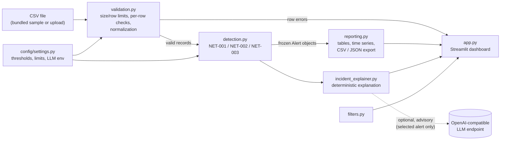

# NetSentry AI

**Rule-based network threat detection and incident analysis — an educational, defensive log-analysis MVP.**

NetSentry AI reads connection-log CSV files, validates every record, runs three transparent detection
rules, and presents the results in a Streamlit dashboard with filtering, exports and plain-language
incident explanations. An optional LLM can add an *advisory* explanation; it never affects detection.

> **All bundled records are synthetic.** They use documentation-only IP ranges (RFC 5737:
> `192.0.2.0/24`, `198.51.100.0/24`, `203.0.113.0/24`) and do not represent real captured traffic.
> This project is for educational defensive analysis only.

## What it is (and isn't)

- ✅ A passive log analyzer: it only reads CSV records you give it.
- ✅ Deterministic, explainable rules with configurable thresholds.
- ✅ Works fully offline, with no API key.
- ❌ Not a network scanner, IDS/IPS, or production security tool. It does no packet capture,
  injection, exploitation, credential collection or automatic blocking.
- ❌ No claim of real-world detection accuracy. The rules catch only the narrow patterns described
  below and will produce false positives and false negatives.

## Architecture



| Module | Responsibility |
| --- | --- |
| `config/settings.py` | Detection thresholds, upload limits, LLM settings from environment variables |
| `netsentry/schemas.py` | Input columns, `Severity`, frozen `Alert` dataclass, `RowError` |
| `netsentry/validation.py` | Untrusted-CSV parsing, per-row validation and normalization (no UI code) |
| `netsentry/detection.py` | Pure rule engine: records in, alerts out (no Streamlit, no LLM) |
| `netsentry/reporting.py` | Severity counts, top sources, time series, CSV/JSON export |
| `netsentry/incident_explainer.py` | Deterministic explanations + optional, validated LLM explanation |
| `netsentry/filters.py` | IP/CIDR, protocol, action and time-range filters for the explorer |
| `app.py` | Streamlit UI only |
| `scripts/generate_sample_data.py` | Regenerates the synthetic dataset deterministically |

## Input schema

```csv
timestamp,src_ip,dst_ip,src_port,dst_port,protocol,bytes_sent,action
2026-10-26T10:00:00Z,192.0.2.10,198.51.100.20,51000,443,TCP,1500,ALLOW
```

One record is **one connection event**, not necessarily a complete TCP session.

| Column | Rule |
| --- | --- |
| `timestamp` | ISO 8601 with a time component. Converted to UTC; a value with no offset is treated as UTC. |
| `src_ip`, `dst_ip` | Valid IPv4 or IPv6 (Python `ipaddress`); stored in canonical form. |
| `src_port`, `dst_port` | Whole number from 1 to 65535. (ICMP has no ports; the schema still requires a value — the sample uses `1`.) |
| `protocol` | `TCP`, `UDP` or `ICMP` (case-insensitive, normalized to uppercase). |
| `bytes_sent` | Non-negative whole number. |
| `action` | `ALLOW` or `DENY` (case-insensitive, normalized to uppercase). |

Validation behaviour:

- Missing required columns, non-UTF-8 content, unparseable CSV, files over **5 MiB** or over
  **50,000 rows** reject the whole file (limits in `UploadLimits`).
- Otherwise each invalid row is rejected with a message naming the CSV line and column, e.g.
  `Row 3, column 'dst_port': port must be between 1 and 65535 (got 0)`.
  Invalid rows are never repaired; you can choose to load only the valid rows.
- Extra columns are ignored.

## Detection rules

All thresholds live in `DetectionConfig` (`config/settings.py`) and can also be adjusted live in the
dashboard sidebar.

| Rule | Name | Logic | Default | Severity |
| --- | --- | --- | --- | --- |
| NET-001 | Potential port scan | Unique `dst_port` values per source in a sliding window | ≥ **15** ports in **5 min** | HIGH |
| NET-002 | High data transfer | Sum of `bytes_sent` per source in a sliding window | ≥ **50 MiB** in **5 min** | MEDIUM |
| NET-003 | Off-hours connection | Events outside business hours in a configured timezone | **09:00 (incl.) – 18:00 (excl.) UTC** | LOW |

**Windows and de-duplication.** For NET-001/NET-002, each source IP is processed independently.
For every event, the window holds that event and earlier events from the same source within the
window length (two-pointer sliding window). Windows that meet the threshold *and share at least one
event* are merged into one **episode**, and each episode produces exactly one alert. A continuous
10-minute scan gives one alert; two scans an hour apart give two. The alert timestamp is the moment
the threshold was first reached; the evidence also records the peak window and the whole episode.

**NET-003 grouping.** To keep the list readable, off-hours events are grouped into one alert per
source IP per local calendar date, with every event time listed in the evidence. Off-hours activity
is **not** proof of malicious behaviour.

**Alert IDs** are deterministic, so the same input always yields the same IDs. Each ID is the rule ID,
a hyphen, and the first 10 hex characters of a SHA-256 hash (`make_alert_id` in
`netsentry/detection.py`):

```text
alert_id = f"{rule_id}-{sha256(f'{rule_id}|{src_ip}|{start}|{end}')[:10]}"
example:   NET-001-8633d78ee9
```

`start` and `end` are the first and last event timestamps covered by the alert, formatted as
`YYYY-MM-DDTHH:MM:SSZ`. For NET-001/NET-002 these are the episode bounds; for NET-003 they are the
first and last off-hours events for that source on that local date.

Every alert has `alert_id`, `rule_id`, `rule_name`, `timestamp`, `src_ip`, `severity`, `summary`,
`evidence` and `recommended_actions`.

### Alerts produced by the bundled sample

| alert_id | rule | severity | src_ip | summary |
| --- | --- | --- | --- | --- |
| NET-003-39d1bdc1bf | NET-003 | LOW | 192.0.2.77 | 5 connections outside business hours on 2026-10-26 |
| NET-001-8633d78ee9 | NET-001 | HIGH | 203.0.113.50 | 25 unique destination ports within 5 minutes (threshold 15) |
| NET-002-ef8be1b741 | NET-002 | MEDIUM | 192.0.2.25 | 66.02 MiB in 6 events within 5 minutes (threshold 50 MiB) |
| NET-003-b635ec15c9 | NET-003 | LOW | 192.0.2.14 | 3 connections outside business hours |
| NET-003-af1d2aeef1 | NET-003 | LOW | 203.0.113.9 | 1 connection outside business hours |

### Example JSON report (abbreviated)

The **Security Alerts** page exports all alerts as JSON (and the filtered view as CSV):

```json
{
  "report": {
    "tool": "NetSentry AI",
    "version": "0.1.0",
    "generated_at": "2026-10-26T12:00:00Z",
    "data_source": "Bundled synthetic sample",
    "records_analyzed": 279,
    "alert_count": 5,
    "severity_counts": { "HIGH": 1, "MEDIUM": 1, "LOW": 3 },
    "detection_config": {
      "port_scan_window_seconds": 300,
      "port_scan_unique_ports_threshold": 15,
      "transfer_window_seconds": 300,
      "transfer_bytes_threshold": 52428800,
      "business_hours_start": "09:00",
      "business_hours_end": "18:00",
      "timezone": "UTC"
    },
    "disclaimer": "Rule-based detections for educational defensive analysis. Alerts are leads for investigation, not proof of malicious activity."
  },
  "alerts": [
    {
      "alert_id": "NET-001-8633d78ee9",
      "rule_id": "NET-001",
      "rule_name": "Potential port scan",
      "timestamp": "2026-10-26T10:16:53Z",
      "src_ip": "203.0.113.50",
      "severity": "HIGH",
      "summary": "203.0.113.50 contacted 25 unique destination ports within 5 minutes (threshold 15).",
      "evidence": {
        "threshold_unique_ports": 15,
        "observed_unique_ports": 25,
        "window_seconds": 300,
        "peak_window_start": "2026-10-26T10:15:00Z",
        "peak_window_end": "2026-10-26T10:18:14Z",
        "peak_window_ports": [21, 22, 23, 25, 53, 80, 110, "…", 9200],
        "destination_ports": [21, 22, 23, 25, 53, 80, 110, "…", 9200],
        "destination_ports_truncated": false,
        "episode_unique_ports": 25,
        "episode_start": "2026-10-26T10:15:00Z",
        "episode_end": "2026-10-26T10:18:14Z",
        "episode_event_count": 25,
        "denied_event_count": 22,
        "destination_ips": ["198.51.100.30"],
        "destination_ips_truncated": false,
        "source_rows": [46, 47, 48, "…", 73]
      },
      "recommended_actions": [
        "Inspect all connections from the source IP around the alert window.",
        "Check whether the source is an approved vulnerability scanner or monitoring tool.",
        "Correlate with firewall, IDS and endpoint logs for the destination hosts.",
        "Review whether any contacted ports were ALLOWED and exposed unexpectedly.",
        "Escalate according to your organization's incident-response procedures if unexplained."
      ]
    }
  ]
}
```

(`"…"` marks list items omitted here for brevity; real exports contain the full lists, capped at 50
items with a `*_truncated` flag.)

## Installation and running

Requires **Python 3.11+**.

```bash
python3 -m venv .venv
source .venv/bin/activate          # Windows: .venv\Scripts\activate
pip install -r requirements.txt
streamlit run app.py
```

Open <http://localhost:8501>. The bundled synthetic dataset loads automatically; use
**Data Management** to upload your own CSV or restore the sample.

Dashboard pages: **Overview** (metrics, time series, top sources, recent alerts) · **Traffic
Explorer** (filter by source/destination IP or CIDR, protocol, action, time range) · **Security
Alerts** (filter, inspect evidence, export CSV/JSON) · **Incident Explainer** (deterministic + optional
AI explanation) · **Data Management** (load/restore sample, validated upload).

To regenerate the synthetic dataset (deterministic, fixed seed):

```bash
python scripts/generate_sample_data.py
```

## Running tests

```bash
python -m pytest
```

The suite (64 tests) covers validation (valid rows, bad IPs/ports/timestamps, negative bytes,
missing columns, size/row limits, malformed files), each rule's threshold boundaries, overlapping-window
de-duplication, independent per-source analysis, timezone handling, empty datasets, JSON/CSV
serialization, LLM failure modes (missing credentials, timeouts, HTTP errors, malformed output — all
with fakes, no network), and a headless render of every dashboard page via Streamlit's `AppTest`.
GitHub Actions (`.github/workflows/tests.yml`) runs it on every push and pull request with Python 3.11 and 3.12.

## Optional LLM explanations

The Incident Explainer can request an **advisory** explanation from any OpenAI-compatible
`/chat/completions` endpoint. Configure it with environment variables (see `.env.example`):

| Variable | Meaning |
| --- | --- |
| `NETSENTRY_LLM_API_URL` | Full chat-completions URL, e.g. `https://provider.example/v1/chat/completions` |
| `NETSENTRY_LLM_MODEL` | Model name |
| `NETSENTRY_LLM_API_KEY` | API key (sent as a Bearer token) |
| `NETSENTRY_LLM_TIMEOUT` | Optional request timeout in seconds (default 20) |

The app does not read `.env` files by itself. Export the variables in your shell first, for example:

```bash
cp .env.example .env    # then edit .env with your values
set -a; source .env; set +a
streamlit run app.py
```

Design safeguards:

- Only the selected alert's rule, severity, summary and (truncated) evidence are sent — never the full
  dataset or raw source-row numbers.
- The system prompt states that alert data is untrusted and must not be treated as instructions.
  Because every evidence value comes from validated fields (IPs, integers, fixed enums, timestamps),
  there is little room for injected text in the first place.
- The response must be a JSON object with `explanation`, `benign_explanations` and
  `investigation_steps`; it is parsed, type-checked and length-capped. Anything else is reported as
  an error.
- `Alert` objects are frozen dataclasses and the LLM result is a separate object, so model output
  cannot alter IDs, severity or rule outcomes. The UI labels it "advisory only".
- Missing configuration, timeouts, network/HTTP errors and malformed responses are shown as a
  message; the rest of the app is unaffected.

## Security considerations

- Uploaded CSVs are untrusted: size and row limits are checked first, every value is parsed
  explicitly (no `eval`, no shell, no dynamic code), and errors are reported per row.
- The API key is read from the environment at call time, excluded from `LLMConfig.__repr__`, and
  never logged or shown in the UI. `.env` is git-ignored; `.env.example` holds placeholders only.
- HTML is only injected into the page for fixed styling and severity badges built from the
  `Severity` enum — never from uploaded data.
- Exception handling is narrow (specific `ValueError`, `ParserError`, `requests` exceptions) so real
  bugs are not silently swallowed.

## Limitations and false positives

- **Thresholds are generic.** Vulnerability scanners, monitoring agents and service discovery trip
  NET-001; backups, updates and file sync trip NET-002; scheduled jobs, on-call work and remote staff
  trip NET-003. Tune thresholds per environment and maintain allow-lists in a real deployment.
- **Evasion is easy.** A slow scan (fewer than 15 ports per 5 minutes), traffic split across many
  sources, or transfers just under the threshold are not detected.
- **Records are events, not sessions**, and the tool only sees `bytes_sent` from the source side.
- **No enrichment** (asset inventory, threat intel, user identity) and no correlation across rules.
- **Single process, in-memory.** No persistence, authentication or multi-user support; the
  50,000-row limit keeps it responsive.
- ICMP records still require port values because of the fixed schema.
- This is an MVP for learning and demonstration, **not a production-grade security product**, and it
  does not detect every — or most — types of attack.

## Project layout

```
app.py                         Streamlit dashboard
config/settings.py             Thresholds, limits, LLM env config
netsentry/                     schemas, validation, detection, filters, reporting, incident_explainer
data/sample_traffic.csv        279 synthetic records (RFC 5737 addresses)
scripts/generate_sample_data.py
tests/                         pytest suite (validation, detection, reporting/LLM, app smoke tests)
.streamlit/config.toml         Dark theme, upload cap
.github/workflows/tests.yml    CI
```
